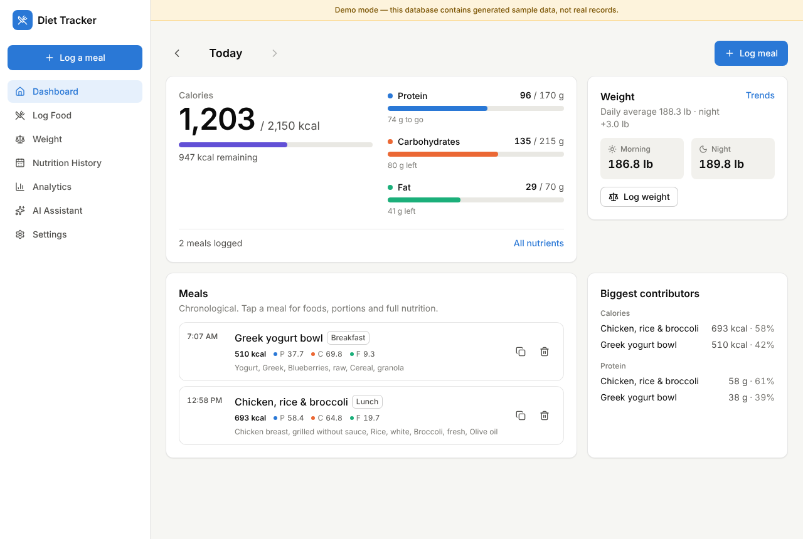
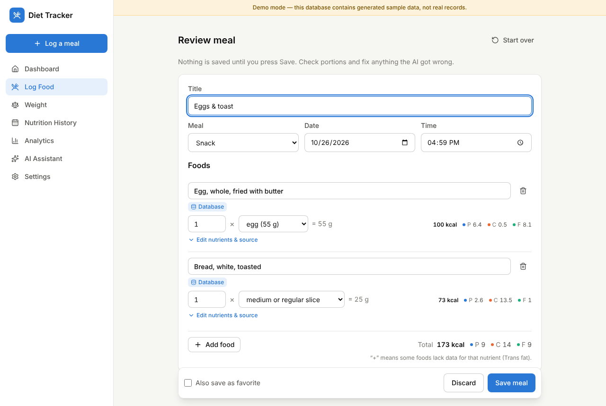
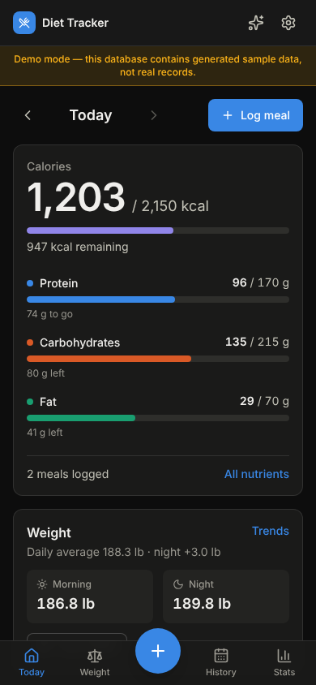

# Diet Tracker

A personal nutrition, macro and weight tracker with AI-assisted food logging.
Describe a meal in plain English or snap a photo; Claude identifies the foods
and portions, the USDA FoodData Central database supplies the nutrient values,
and the app computes every total deterministically. Weight, intake and goal
history turn into trends, analytics and an assistant that answers questions
from your own data.

- **Stack:** Next.js 16 (App Router, TypeScript) · Tailwind CSS 4 · Recharts ·
  PostgreSQL via Drizzle ORM (embedded PGlite or any hosted Postgres) ·
  Anthropic Claude API · USDA FoodData Central.
- **Single-user:** password login, all data in your own database.

| Dashboard | Reviewing a meal before saving | Mobile (dark) |
|---|---|---|
|  |  |  |

More: [weight trends](docs/images/weight.png) · [analytics](docs/images/analytics.png).
Screenshots use the generated demo data (`npm run demo`), not real records.

---

## Quick start (local)

Requirements: Node.js 20.9+ (22 recommended).

```bash
npm install
cp .env.example .env.local        # then fill in what you need (all optional locally)
npm run usda:import               # one-time: stores ~13,000 USDA foods locally (~25 s)
npm run dev                       # http://localhost:3000
```

With no configuration the app runs with an **embedded PostgreSQL database**
(PGlite) in `./data/pglite`, no login (development only), and without AI
features. Add `ANTHROPIC_API_KEY` to `.env.local` to enable photo/text
analysis and the assistant.

Want to look around first? `npm run demo` creates a separate, clearly labelled
demo database (`./data/pglite-demo`, ~90 days of sample meals and weigh-ins)
and starts the app on it. It never touches your real data.

## Environment variables

| Variable | Required | Purpose |
|---|---|---|
| `APP_PASSWORD` | production | Password for the single-user login. Without it (and `SESSION_SECRET`) a production server refuses to serve. |
| `SESSION_SECRET` | production | 32+ random characters used to sign the session cookie (`openssl rand -base64 48`). |
| `ANTHROPIC_API_KEY` | for AI | Enables text/photo meal analysis and the assistant. Get one at [console.anthropic.com](https://console.anthropic.com/). |
| `ANTHROPIC_MODEL` | no | Defaults to `claude-opus-5-5`. |
| `ANTHROPIC_FALLBACKS` | no | Server-side refusal fallback is on by default; set `off` if a gateway rejects it. |
| `FDC_API_KEY` | recommended | Free [USDA API key](https://fdc.nal.usda.gov/api-key-signup) for online lookups (branded products, foods not in the local copy). Without it the shared, heavily rate-limited `DEMO_KEY` is used. |
| `DATABASE_URL` | hosted deploys | PostgreSQL connection string. Empty = embedded database in `PGLITE_DIR`. |
| `PGLITE_DIR` | no | Embedded database folder (default `./data/pglite`). |
| `AUTO_MIGRATE` | no | `true` to apply migrations on startup when using `DATABASE_URL`. |
| `DATABASE_PREPARE` | no | Leave `false` for transaction-mode poolers (Supabase pooler, PgBouncer). |
| `IMAGE_STORAGE` | no | `db` (default, photos stored in Postgres) or `s3` (any S3-compatible bucket; set `S3_ENDPOINT`, `S3_BUCKET`, `S3_REGION`, `S3_ACCESS_KEY_ID`, `S3_SECRET_ACCESS_KEY`). |

All secrets are read only on the server; nothing is exposed to the browser.

## Database and migrations

- Schema: `src/lib/db/schema.ts`; SQL migrations: `drizzle/`.
- **Embedded (PGlite):** migrations run automatically on startup.
- **PostgreSQL:** run `npm run db:migrate` (with `DATABASE_URL` set) once per
  deploy, or set `AUTO_MIGRATE=true`.
- After changing the schema: `npm run db:generate` creates a new migration.

Tables: `settings`, `goals` (versioned by effective date), `weight_entries`,
`meals`, `meal_items`, `meal_images`, `meal_analyses` (AI drafts),
`saved_meals`, `foods` (USDA + custom), `chat_conversations`,
`chat_messages`, `assistant_actions`.

## Nutrition data (USDA FoodData Central)

`npm run usda:import` downloads two official USDA datasets (cached in
`./data/usda`) and upserts them into the `foods` table:

- **FNDDS survey foods** (~5,400 “as eaten” foods with household portions
  like “1 large egg = 50 g”),
- **SR Legacy** (~7,800 reference foods).

Search is local full-text search (fast, offline, no rate limits). If local
results are thin, or you search branded products, the app queries the USDA
API and caches the results. You can also create custom foods from a nutrition
label. To load the foods into a hosted database, run the import with
`DATABASE_URL` set.

## AI setup (Claude)

1. Set `ANTHROPIC_API_KEY` (and optionally `ANTHROPIC_MODEL`).
2. Restart. **Settings → System status** shows whether AI is configured.

How the AI is used — and what it is *not* trusted with:

- **Meal analysis** (text or up to 4 photos): Claude splits the meal into
  foods, estimates portions in grams, and calls a `search_foods` tool against
  the USDA database to pick matches. The server then takes nutrient values from
  the matched database rows and computes all totals itself. Only foods without
  a database match use the model's per-100 g estimate, and they are labelled
  **AI estimate**. Implausible matches (database vs. estimate differ >2.5×) are
  flagged for review. When portions, oils or ingredients materially change the
  estimate, Claude asks up to 3 short clarifying questions.
- **Nothing is saved until you confirm** the draft (unless you tick *Quick
  save*). Requests carry an idempotency key, so a retried request returns the
  existing result instead of creating duplicates.
- **Assistant:** answers questions by calling read-only tools over your data
  (daily summaries, statistics, rankings, period comparisons, weight vs.
  intake). It can only *propose* changes (log a weight, update goals, delete an
  entry); they run after you press **Confirm**.

The app uses adaptive thinking with `effort: medium`, prompt caching, and the
server-side refusal fallback. Each meal analysis is typically a few model
calls (search → final answer); photo analysis costs more input tokens.

## Authentication & security

- Single-user password login (`APP_PASSWORD`), HS256-signed HTTP-only
  `SameSite=Lax` session cookie (30 days), login rate limiting, and an
  origin check on all state-changing API requests.
- Production refuses to run without `APP_PASSWORD` + `SESSION_SECRET`.
- Uploaded photos are validated by magic bytes (JPEG/PNG/WebP/GIF, ≤5 MB after
  in-browser resizing), served only to the signed-in user with
  `Content-Security-Policy: default-src 'none'`.
- CSV exports neutralize spreadsheet formula injection.

## Deployment

### Option A — your own server (simplest; embedded database)

```bash
npm ci && npm run build
APP_PASSWORD=… SESSION_SECRET=… ANTHROPIC_API_KEY=… npm start   # port 3000
npm run usda:import    # once
```

Put it behind HTTPS (Caddy, nginx, Cloudflare Tunnel…) and back up
`./data/` (or use *Settings → Export & backup*). A `Dockerfile` and
`docker-compose.yml` are included (`docker compose up -d --build`, data in
`./data`).

### Option B — Vercel (or any serverless host) + hosted PostgreSQL

1. Create a Postgres database (Supabase, Neon, …) and copy its connection
   string (for Supabase use the pooler URL; keep `DATABASE_PREPARE=false`).
2. Locally: `DATABASE_URL=… npm run db:migrate && DATABASE_URL=… npm run usda:import`.
3. Import the repo in Vercel and set `DATABASE_URL`, `APP_PASSWORD`,
   `SESSION_SECRET`, `ANTHROPIC_API_KEY`, `FDC_API_KEY` (and S3 settings if you
   prefer bucket storage for photos).
4. AI routes declare `maxDuration = 300`; make sure your plan allows long
   enough function durations (analysis usually takes 10–40 s).

The embedded database is refused on serverless platforms because their disks
are ephemeral.

## Testing

```bash
npm test             # unit/integration tests (Vitest, in-memory PostgreSQL)
npm run test:e2e     # Playwright: production build + fresh database + real browser
E2E_DATABASE_URL=postgres://…/empty_db npm run test:e2e   # same suite on PostgreSQL
npm run lint && npm run typecheck
```

Coverage includes: nutrient math and precision, partial-data handling,
time zones and late-night meals, DST, weight statistics (rolling/weekly/monthly
averages, trends, missing days), goal versioning, adherence, correlations,
meal create/edit/delete → daily totals, idempotent retries, USDA parsing and
search ranking, backup/restore, the AI tool loop and database resolution (with
a scripted model client), the assistant's confirm-before-change flow, image
validation, auth, and full UI flows in a browser.

## Project structure

```
src/
  app/                 Next.js routes: (app)/ pages, login, api/ route handlers
  views/               Page-level client components (dashboard, log, weight, …)
  components/          UI primitives, charts, item editor, food search, …
  lib/
    nutrition/         nutrients, deterministic calculator, goals, target suggestions
    weight/stats.ts    weight statistics
    analytics/         nutrition summary, weight ↔ intake relationship
    ai/                Claude client, meal analysis, assistant + tools
    foods/             USDA parsing/import, local search, FDC API client
    services/          meals, weights, settings/goals, stats, analysis, images, export
    db/                Drizzle schema + driver selection (PGlite / Postgres)
    time.ts, units.ts  calendar-date and unit helpers
scripts/               usda:import, db:migrate, demo seeding
drizzle/               SQL migrations
tests/unit, tests/e2e
docs/                  calculations and architecture notes
```

See [docs/calculations.md](docs/calculations.md) for exact definitions of
every statistic and [docs/architecture.md](docs/architecture.md) for the data
flow.

## Features

- **Weight:** morning/night weigh-ins (lb or kg, editable time and day),
  daily average and night−morning change, changes vs. previous day/week/month,
  since start and to target, 7-day rolling average, linear trend, weekly and
  monthly averages, fluctuation chart, gaps shown as gaps, edit/delete, ranges
  7d/30d/90d/6m/1y/all.
- **Food logging:** plain-English descriptions, photos (multi-photo, camera
  capture, in-browser resize/HEIC conversion where supported), database search,
  manual label entry, custom foods, saved favorites, recent meals, duplicate,
  custom meal categories, back-dated entries, clarifying questions, per-item
  editing of foods, amounts, units/portions and every nutrient, re-matching to a
  different database entry, quick-save option.
- **Nutrition tracking:** calories, protein, carbs, fat plus saturated/trans
  fat, fiber, sugar, sodium, cholesterol, potassium, calcium, iron, magnesium,
  zinc and vitamins A, C, D, B12 and folate. Each food is labelled
  *Database*, *AI estimate* or *Manual*, keeps its USDA reference, the original
  AI estimate, confidence and assumptions.
- **Dashboard:** totals vs. goals with remaining amounts, macro progress,
  weigh-ins, chronological meal timeline, biggest calorie/protein contributors,
  all-nutrient view, date navigation, missing-weigh-in banner.
- **Analytics:** averages (all nutrients), highs/lows, meals per day, goal
  adherence, % days meeting all macro goals, week-over-week table, day-to-day
  variability, meal-category composition, logging streaks, calorie and macro
  trends, weight vs. calories and weekly averages (stacked, synchronized
  charts), caveated observations, preset and custom ranges with data
  completeness. Every chart has a table view.
- **Assistant:** streaming chat over your data with confirm-gated changes.
- **Settings:** versioned goals, optional target calculator with stated
  assumptions, extra nutrient targets, units, time zone, day-start hour,
  week start, categories, reminders, theme, CSV exports, full JSON backup and
  restore.
- Responsive layout with mobile bottom navigation, dark/light themes, PWA
  manifest (add to home screen).

## Limitations and things that need configuration

- **AI features require `ANTHROPIC_API_KEY`.** Without it, logging works via
  database search and manual entry; the AI paths show a clear message. In the
  build environment no API key was available, so the AI pipeline was verified
  with automated tests using a scripted model client (tool loop, validation,
  database resolution, idempotency, confirmations) but **not against the live
  Claude API** — run a few real analyses after adding your key.
- **USDA data must be imported once** (`npm run usda:import`); otherwise
  searches rely on the rate-limited USDA API.
- **Reminders** are browser notifications while the app (or installed PWA) is
  open; true background push notifications are not implemented.
- Single user only; no multi-account support.
- Photo-based portion estimates are inherently approximate; they are labelled
  as estimates with confidence levels and should be reviewed.
- Micronutrient totals are only as complete as the underlying foods; AI
  estimates usually include only a few nutrients, and totals are marked partial.
- The Dockerfile was not built in the development environment (no Docker
  daemon available); the app itself was verified with `next build`/`next start`.

Nutrition estimates and suggestions are informational and not medical advice.
